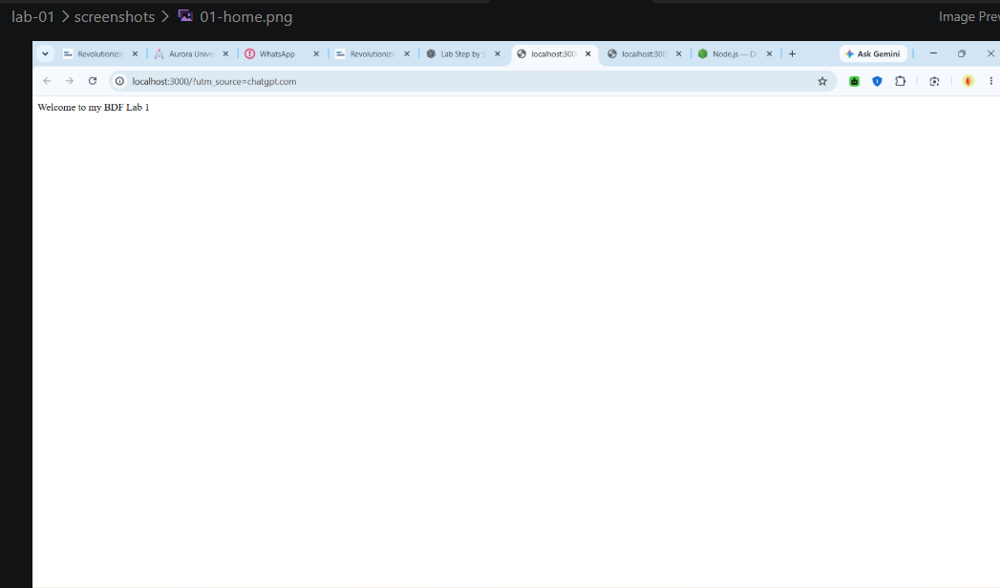
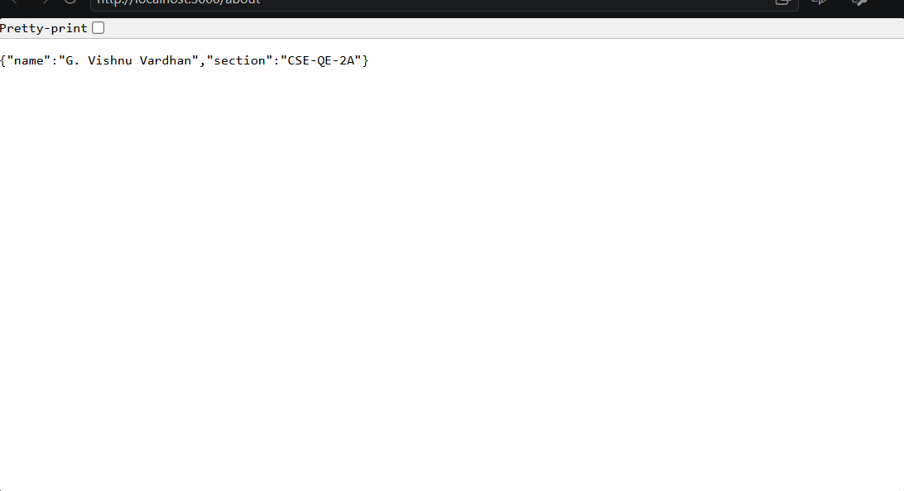
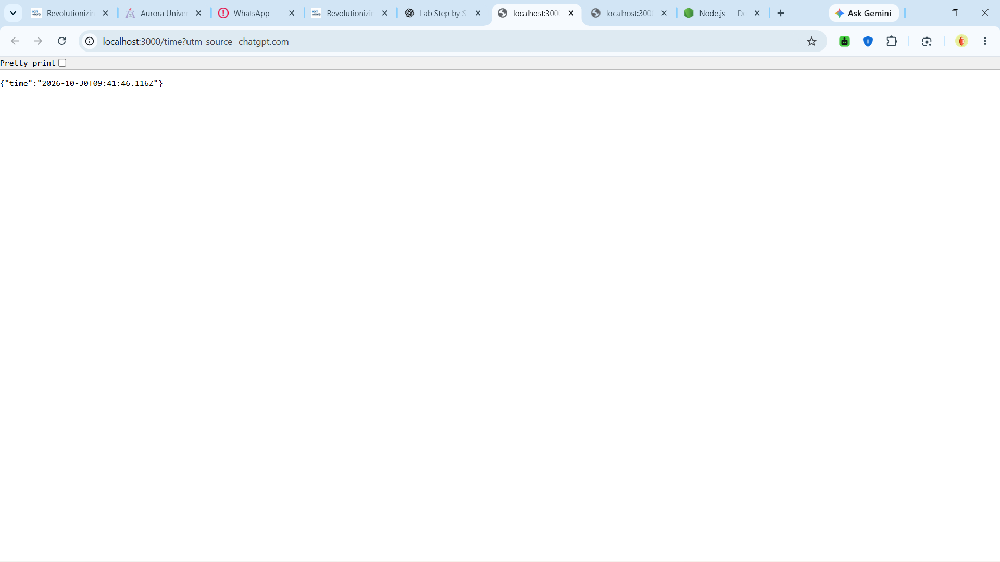
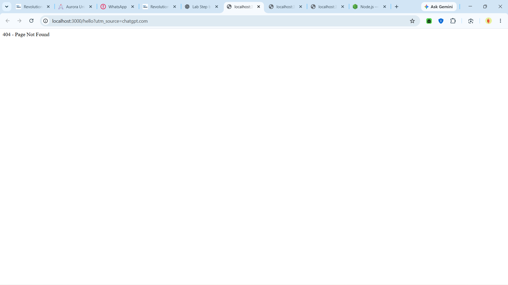

# Lab 1: Node.js and Express server

## Student Details
- Name:G vishnu vardhan
- Registration Number:252U1R8026
- Section: CSE QE-2A

## Objective
To create a Node.js HTTP server and an Express server
with routes and appropriate status codes.

## How to Run
1. Install Node.js.
2. Open the lab-01 folder in the terminal.
3. Run npm install.
4. Run node server.js.
5. Open http://localhost:3000 in a browser.

## Endpoints

| Method | Path | Description |
|--------|------|-------------|
| GET | / | Displays welcome message |
| GET | /about | Displays name and section |
| GET | /time | Displays current date and time |
| GET | /hello | Tests the 404 response |

## Screenshots

# Lab 1: Node.js and Express Server

## Screenshots

### Home Page

### About Page

### Time Page

### 404 Response

## Notes
Tested the Express routes and checked their status codes.
