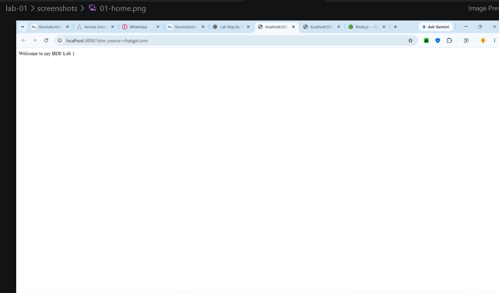
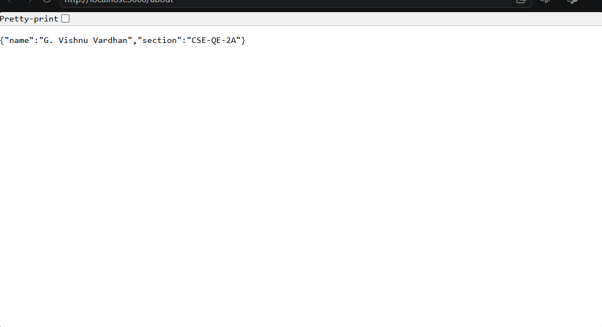
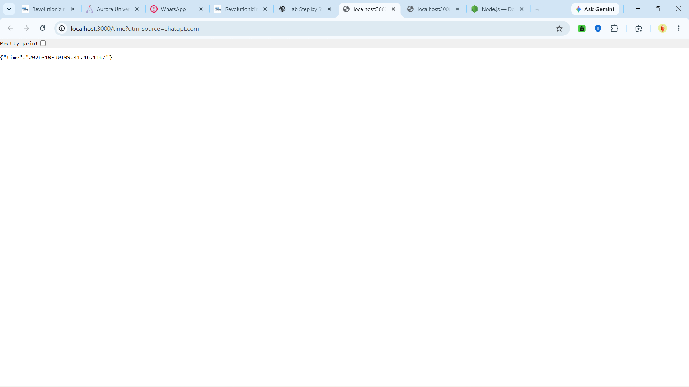
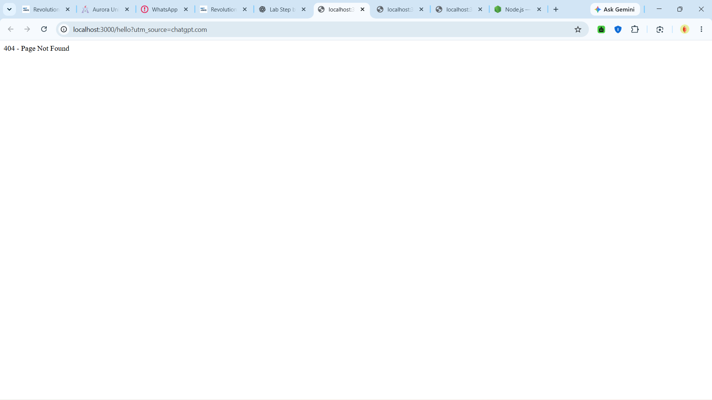

# BDF Lab 1 - Node.js and Express Server

## Student Details
- Name: G. Vishnu Vardhan
- Section: CSE-QE-2A

## Project Description
This project demonstrates creating a basic HTTP server using Node.js and Express.js.

## Routes
- `/` - Home page
- `/about` - Student details
- `/time` - Current server time
- `/hello` - Tests the 404 response

## Screenshots

### Home Page

### About Page

### Time Page

### 404 Response

## Live Website
Add your Render URL here after deployment.

## GitHub Repository
https://github.com/vishnu-9990/BDF-lab-1